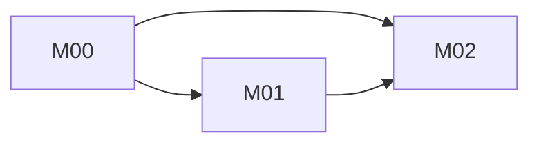

# Mapa de módulos

Regla: un módulo cubre un proceso de negocio completo, entrega valor por sí solo y dura de 2 a 6 semanas. Si excede eso, se divide.

| ID | Prefijo | Nombre | Proceso que cubre | Valor que entrega | Depende de | Prioridad | Estado |
|---|---|---|---|---|---|---|---|
| M00 | BAS | Fundación | Auth, roles, catálogos, layout | Base para todo | n/a | 0 | futuro |
| M01 | [ ] | [ ] | [PR-xx] | [ ] | M00 | 1 | futuro |
| M02 | [ ] | [ ] | [PR-xx] | [ ] | M00, M01 | 2 | futuro |

## Dependencias (diagrama)

## Procesos sin módulo asignado
- [Procesos del mapa que aún no se asignan y por qué]

## Aprobación del cliente
Nombre: [ ]  Firma: [ ]  Fecha: [ ]
