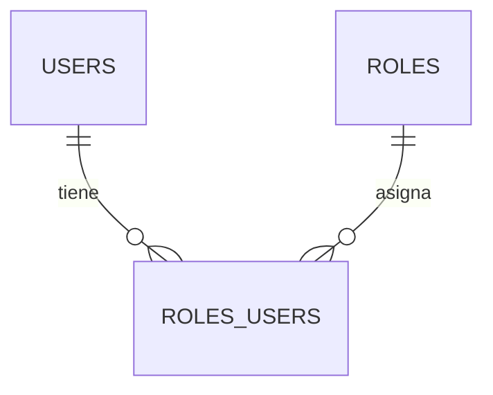

# Modelo de datos global (entidades compartidas)

Regla: cada tabla compartida tiene un **módulo dueño**. Otros módulos pueden leerla o referenciarla, pero no modificar su estructura sin solicitud de cambio.

| Entidad / Tabla | Descripción | Módulo dueño | Módulos que la usan |
|---|---|---|---|
| users | Usuarios del sistema | M00 | todos |
| roles | Roles y permisos | M00 | todos |
| [catalogo_x] | [ ] | [Mxx] | [ ] |

## Relaciones clave

## Reglas comunes
- Toda tabla lleva: `id`, `created_at`, `updated_at`, [`deleted_at` si hay borrado lógico], [`created_by`].
- [Convención de claves foráneas, nulos, tipos de dinero y fecha.]
