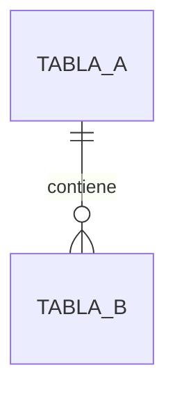

# Modelo de datos del módulo [Mxx]

## Diagrama

## Tablas propias
### `[nombre_tabla]`
| Campo | Tipo | Nulo | Default | Descripción | Requerimiento / Regla |
|---|---|---|---|---|---|
| id | bigint PK | No | | | |
| [ ] | [ ] | [ ] | [ ] | [ ] | [MOD]-RF-001 |

**Índices:** [ ]
**Restricciones:** [ ]

## Tablas referenciadas (de otros módulos)
| Tabla | Módulo dueño | Campos que usamos | Tipo de uso (lectura / FK) |
|---|---|---|---|
| [ ] | [Mxx] | [ ] | [ ] |

> Si necesitas modificar una tabla de otro módulo, abre una solicitud de cambio.
